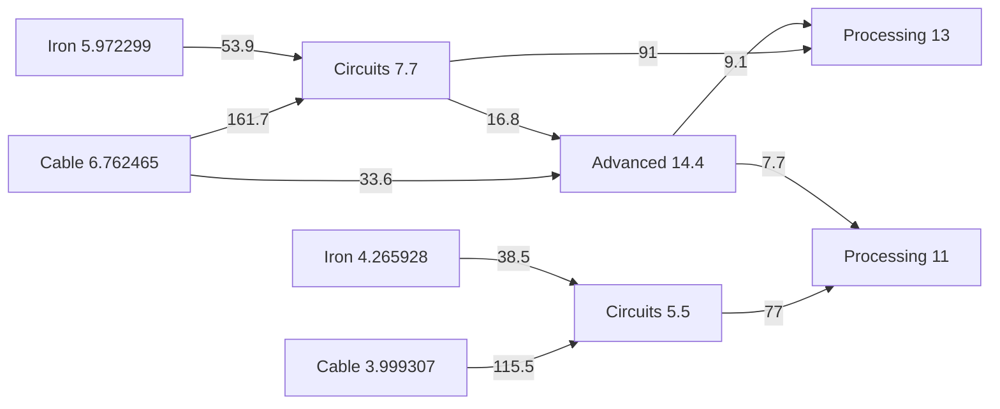

# Joint fractional placement experiment

Run the user's five-recipe processing-unit example with the installed `highs` package:

```sh
node scripts/experiment-placement-splits.ts - /tmp/placement-splits.json
```

Replace `-` with a JSON file matching the example's `inputs`, `recipes`, `layoutOptions`, and
`outputs` structure. Rates are whole-recipe totals; `ratio` fields are ignored. The JSON report
retains every candidate's workloads, installed capacity, material flows, score components, exclusive
pairs, bounds, and timing. The runner tries fixed integer baselines and six MILP configurations. It
also rescores every result with the same default weights and 60-item/s belts.

Implementation: [`../../scripts/placement-milp.ts`](../../scripts/placement-milp.ts). This is a
command-line experiment; the application still uses its existing placement planner.

## Model

Each recipe has enough optional stack slots to cover its workload at its largest advertised kernel
capacity, plus configurable extra slots. Workloads are continuous variables whose sum is exactly the
solved count. Installed buildings are integer capacity variables, heavily penalized above the
original per-recipe ceiling. Each active stack selects an advertised footprint/capacity envelope.
Buildings can be fewer than that envelope's maximum capacity; the entire envelope's area is charged.

Every compatible producer/consumer stack pair has a possible flow for each material. A binary
variable opens that connection; an integer variable counts its belts. Gross input and output flows
are conserved separately at each stack. Declared imports and exports have their own conserved flows;
the model cannot create station overflow to avoid an internal connection. A stack cannot supply
itself, matching the existing flow allocator's policy.

An exclusive-output pair sends **every output material** of the producer to the consumer. An
exclusive-input pair gets **every input material** of the consumer from that producer. Imports,
byproduct exports, and other consumers exclude those rewards. Mutual pairs satisfy both conditions.
Rewards apply once per ordered pair, even if several materials travel between them. Individual
material fan-out and merges are charged separately through `degree - 1`.

The default objective is:

```text
30 × extra buildings
 3 × placements
10 × internal material connections
 2 × belt trunks and fluid pipes, including boundary branches
 2 × boundary material connections
 4 × additional branches and merges per stack/material interface
-4 × exclusive-output pairs
-4 × exclusive-input pairs
-2 × mutual pairs
0.001 × advertised footprint area
```

An item flow needs `ceil(rate / beltCapacity)` belts; a fluid flow needs one pipe. No distance or
crossing cost is modeled. These are full-belt estimates; kernel lane and inserter feasibility still
need actual port metadata.

## Results on the supplied example

All scores in this table use default weights and 60-item/s belts, including candidates obtained with
other objectives. Counts are internal connections and belts; station branches are priced too.

| Candidate                  | Buildings | Placements | Connections | Belts | Exclusive outputs | Common score |
| -------------------------- | --------: | ---------: | ----------: | ----: | ----------------: | -----------: |
| Capacity-first fixed split |        75 |          9 |          13 |    17 |                 2 |      255.422 |
| Balanced fixed split       |        75 |          9 |          13 |    18 |                 1 |      261.444 |
| Joint fractional split     |        75 |          9 |          10 |    15 |                 4 |      189.444 |
| Dedicated cable feeds      |        76 |         10 |          10 |    15 |                 6 |      214.489 |
| Strong exclusivity reward  |        75 |         12 |          13 |    17 |                 8 |      228.534 |

The fixed baselines use the existing sparse flow allocator with the same abstract envelopes. They
are comparison partitions, not the current application's shortlisted whole-cell search.

The joint fractional split assigns:

| Recipe               | Workloads           | Installed buildings |
| -------------------- | ------------------- | ------------------- |
| Processing unit      | 13 + 11             | 13 + 11             |
| Electronic circuit   | 7.7 + 5.5           | 8 + 6               |
| Casting copper cable | 6.762465 + 3.999307 | 7 + 4               |
| Casting iron         | 5.972299 + 4.265928 | 6 + 5               |
| Advanced circuit     | 14.4                | 15                  |

Its important flows, in items/s:



Both iron stacks, the smaller cable stack, and the smaller electronic-circuit stack send all their
output to one consumer. The larger cable/circuit banks retain shared feeds rather than paying for
extra buildings. No pair supplies every input of its consumer: iron and cable come from separate
producers, and other recipes also need external materials or additional intermediates.

The dedicated-feed alternative splits cable work as `5.599030 + 3.999307 + 1.163435`, installing
`6 + 4 + 2` foundries. Those three stacks feed the two circuit stacks and the advanced-circuit stack
exclusively. It saves a branch and creates two more exclusive-output pairs, at the cost of one
building, one placement, and one molten-copper import branch. It wins when the extra-building
penalty is reduced to 5 and the exclusive-output reward raised to 12; default weights favor 75
buildings. This makes the cost of dedicated feeds explicit.

The 180-variable minimum-slot model solved in roughly 70–140 ms, excluding Wasm loading and model
construction. Allowing one extra slot per recipe produced a 382-variable model and took about 0.9
seconds with default weights. Strong exclusivity rewards took the full ten-second budget, leaving an
approximately 18.7% gap in the shifted score. That candidate prefers more small stacks; it has not
proved its objective optimal. Timings and budget-limited results can vary by machine.

## Scope of the result

The model searches workloads jointly, without per-recipe partition shortlists. Its bounds cover only
the available slots, advertised capacity envelopes, and objective. Extra slots broaden that space
and can increase solve time substantially. Positive workloads and connections have a small `1e-4`
lower bound to exclude zero-flow support and reward artifacts; numerical tolerances still apply. The
default stopping tolerance is 0.01 absolute score units. Diagnostics expose both the solver's raw
gap and a gap recomputed after removing the baseline building cost.

The supplied summary omits repeat steps, ports, lane constraints, and entities. The experiment
therefore cannot certify these candidates as buildable kernels. It treats envelopes of equal or
greater capacity and smaller area as dominant because orientation and routing are not scored.
Application integration needs actual supported integer repeats and port capacities before it can
replace [`PLACEMENT-PLAN.md`](PLACEMENT-PLAN.md)'s geometry and station connection path.

Regression coverage checks whole-cell and per-stack conservation, integer capacity, useful soft
building-budget trades, gross cycles, forbidden self-supply, whole-interface exclusivity, and belt
thresholds in
[`../../test/scripts/placement-milp.test.ts`](../../test/scripts/placement-milp.test.ts).
